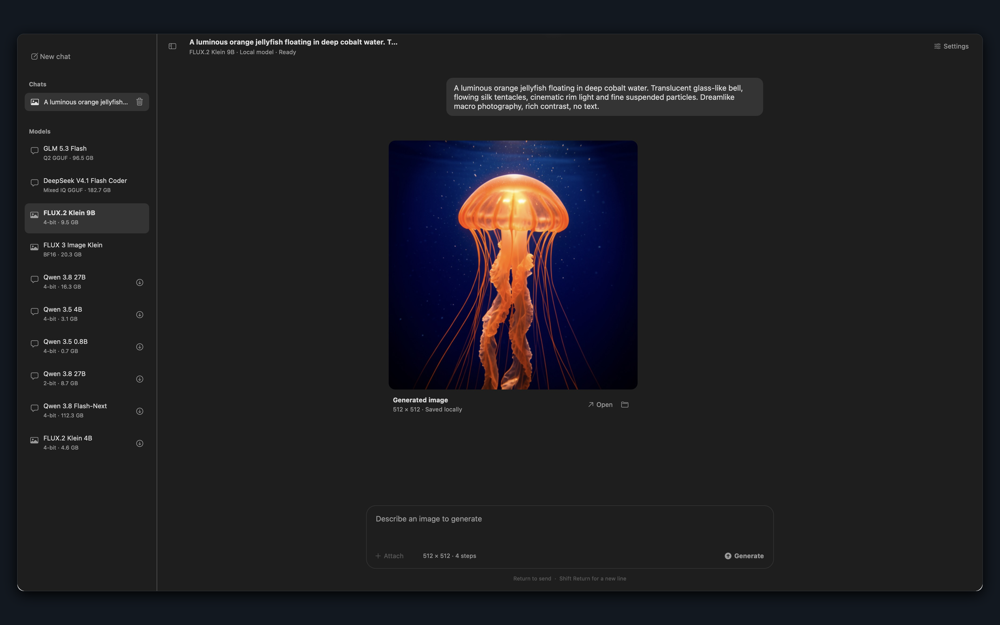

<p align="center">
  
</p>

<h1 align="center">LISA</h1>

<p align="center"><strong>Local AI, built for your Mac.</strong></p>

Chat, write code, understand images and generate them — in a native macOS app,
from your terminal, or through a local API. LISA runs inference on Apple Silicon
with its own Rust engine and Metal runtime.

[Get started](#get-started) · [Models](#supported-models) · [Images](#images) ·
[API](#local-api) · [Documentation](specs/README.md)



*An actual FLUX.2 Klein 9B generation in LISA.*

- **A native workspace.** Saved chats, image attachments, generated-image
  previews and a curated model library in an AppKit interface.
- **Your models, running locally.** Qwen, GLM, DeepSeek and FLUX, using supported
  MLX-format safetensors and original packed GGUF weights.
- **An engine of its own.** Rust model execution, memory management and
  JIT-compiled Metal kernels. No Python inference service is required.
- **Three ways in.** Desktop, CLI and HTTP share the same engine. Multi-token
  prediction (MTP), prefix reuse and batching are available on supported paths.

## Get started

Requires **macOS 15 or later on Apple Silicon**, Apple command line developer
tools and a Rust toolchain supporting edition 2024. Choose a model that leaves enough
unified memory for its weights, context, working buffers and macOS.

```sh
git clone https://github.com/agnosticeng/lisa.git
cd lisa
```

### Open the app

```sh
sh crates/lisa-ui/bundle.sh
open target/dist/Lisa.app
```

The script builds and locally signs the app, keeping debug symbols separately
in `target/dist/lisa-ui.dSYM`. The complete app includes its compressed Metal
source package, `kernels.bin`; the bundle build enforces a 10 MB size limit.
In **Models**, download a checkpoint, then select it to load. Choose a language model to chat or an image
model to generate. Downloaded models appear first; compatible checkpoints
already in your Hugging Face cache are discovered automatically.

Chats and attachments stay in `~/Library/Application Support/Lisa/chats`.
Generated images appear as preview cards and are saved to `~/Pictures/Lisa`.
Use **⌘N** for a new chat, **Return** to send and **Shift-Return** for a new line.

### Use the terminal

```sh
cargo build --release -p lisa-cli

./target/release/lisa run \
  --model mlx-community/Qwen3.5-4B-MLX-4bit \
  --prompt "Explain why the sky is blue in two sentences." \
  --max-tokens 128
```

`--model` accepts a Hugging Face repository ID, a local checkpoint directory
or a supported GGUF file/first shard. Missing checkpoints download into the
standard Hub cache; cached models can run offline.

When copying the CLI elsewhere, keep the generated `kernels.bin` beside it.
The package must come from the same build as the executable.

Text generation defaults to `--depth auto`, enabling MTP when the model and
request support it. Use `--depth 0` for serial generation. The app uses the
same automatic policy. For options, run `./target/release/lisa --help` or a
subcommand's `--help`. Use `run` and `serve` across language-model families;
the interactive CLI `chat` and cohort `batch` commands currently target Qwen4.

## Supported models

These are the desktop app's curated downloads. Model names link to their
Hugging Face checkpoints; exact selections live in
[the catalog](crates/lisa-ui/src/catalog.rs).

### Chat and code

| Model | Weights | Implementation |
| --- | --- | --- |
| [Qwen 3.5 0.8B](https://huggingface.co/mlx-community/Qwen3.5-0.8B-MLX-4bit) | MLX 4-bit | Text and compatible image input |
| [Qwen 3.5 4B](https://huggingface.co/mlx-community/Qwen3.5-4B-MLX-4bit) | MLX 4-bit | Text and compatible image input |
| [Qwen 3.8 27B](https://huggingface.co/agnosticeng/Qwen3.8-27B-4bit) | MLX 4-bit | Text, compatible image input and MTP |
| [Qwen 3.8 27B](https://huggingface.co/agnosticeng/Qwen3.8-27B-2bit) | MLX 2-bit | Text, compatible image input and MTP |
| [Qwen 3.8 Flash-Next](https://huggingface.co/agnosticeng/Qwen3.8-Flash-Next-4bit) | MLX 4-bit | Hybrid MoE and MTP |
| [GLM-5.3 Flash](https://huggingface.co/antirez/glm-5.3-flash-gguf) | DS4 Q2 GGUF | **Experimental** · text and MTP |
| [DeepSeek V4.1 Flash Coder](https://huggingface.co/ISTA-DASLab/DeepSeek-V4.1-Flash-1017-GSQ-RCO-Coder-GGUF) | Mixed IQ GGUF | **Experimental** · text and tools |

**GLM** uses DS4's original `GLM-5.3-Flash-Q2.gguf`, about 90 GiB of weights
for a 128 GB Mac. It needs no conversion or prepared duplicate. Prefill and
target verification still process serial rows; full numerical and performance
parity with DS4 remains open. [GLM status →](specs/models/glm53.md)

**DeepSeek** keeps about 67 GiB of weights resident and reads its roughly
103 GiB Engram table from disk. It needs a high-memory Mac and fast storage.
The selected package has no MTP head, so generation is serial. Broader context
and performance acceptance remains open. [DeepSeek status →](specs/models/deepseek41.md)

### Image generation

| Model | Weights | Default steps |
| --- | --- | ---: |
| [FLUX.2 Klein 4B](https://huggingface.co/mlx-community/flux2-klein-4b-4bit) | MLX 4-bit | 4 |
| [FLUX.2 Klein 9B](https://huggingface.co/mlx-community/flux2-klein-9b-4bit) | MLX 4-bit | 4 |
| [FLUX 3 Image Klein](https://huggingface.co/black-forest-labs/flux-3-image-klein) | BF16 | 16 |

Gated checkpoints, including FLUX 3, require access on Hugging Face and a local
Hub token or `HF_TOKEN`. Model weights have their own licenses and usage terms.

Existing compatible MLX GLM checkpoints remain supported with a prepared
resident index; they are separate from the curated GGUF model. Laya is also
available as a typed-decision model through `decide` and `/v1/decisions`, on
CPU or Metal. See [checkpoint compatibility](specs/architecture.md#checkpoint-dispatch).

## Images

### Ask about an image

Choose a compatible vision model and use **Attach** in the app, or pass
`--image` to the CLI:

```sh
./target/release/lisa run \
  --model mlx-community/Qwen3.5-4B-MLX-4bit \
  --image photo.jpg --prompt "Describe this image." --max-tokens 128
```

PNG, JPEG and WebP are supported; repeat `--image` for multiple inputs.
Vision weights must be present. The curated GLM and DeepSeek GGUF models are
currently text-only. Image turns use serial generation and full image history.

### Make something

Select an image model in the app and use **Generate**, or write a PNG directly:

```sh
./target/release/lisa image \
  --prompt "A translucent amber glass jellyfish, soft studio light, deep blue background" \
  --output jellyfish.png --width 768 --height 512 --seed 42
```

The default is FLUX.2 Klein 4B. Use `--model` to select another image checkpoint.
Dimensions must be multiples of 32, from 64 to 1024 pixels per side. FLUX 3
expands short prompts locally; `--prompt-is-caption` uses your caption directly.

Image generation is text-to-image; editing and LoRA are not implemented.
[Media documentation](specs/media.md) covers input limits, API image formats,
model-specific options and numerical validation.

## Local API

Start a language server:

```sh
./target/release/lisa serve \
  --model mlx-community/Qwen3.5-4B-MLX-4bit \
  --addr 127.0.0.1:8000
```

Then stream a reply from another terminal:

```sh
curl -N http://127.0.0.1:8000/v1/chat/completions \
  -H 'Content-Type: application/json' \
  -d '{
    "model": "mlx-community/Qwen3.5-4B-MLX-4bit",
    "messages": [{"role": "user", "content": "Write a small Python hello world."}],
    "max_tokens": 128,
    "stream": true
  }'
```

The language server exposes OpenAI-compatible chat/completions, Responses,
embeddings and an Anthropic Messages adapter. Features include streaming,
tool calls and supported inline image inputs. The loaded model determines
which capabilities are available.

To serve images, start `serve` with a FLUX model and use
`POST /v1/images/generations`; results contain a base64 PNG in
`data[0].b64_json`. `GET /v1/models` identifies the loaded checkpoint, and
`GET /health` reports server health.

The app can run its server from **Settings** in the chat header. See
[serving documentation](specs/serving.md) for endpoint behavior, structured
output, session/history limits and current compatibility boundaries.

## Under the hood

LISA owns its tensor runtime, allocation, model execution and generation loop.
The workspace separates Metal kernels (`lisa-mlx`), packed-weight storage
(`lisa-gguf`), inference (`lisa-engine`) and the CLI, server and desktop front ends.
MLX and DS4 provide reference implementations and kernel sources; their
attribution is preserved in [NOTICE](NOTICE).

```sh
cargo check --workspace --all-targets --all-features
```

This checks compilation without loading a model. Follow [AGENTS.md](AGENTS.md)
for numerical validation and sequential GPU runs before committing engine changes.

- [Architecture](specs/architecture.md) — components, checkpoint dispatch and ownership.
- [Model status](specs/README.md#model-status) — implemented features and measured coverage.
- [Performance](specs/performance.md) — scoped results and measurement conditions.
- [Roadmap](specs/roadmap.md) — remaining work and acceptance criteria.

LISA is under active development. Model support does not imply every mode or
context length has been validated; the linked specs record those boundaries.

## License

LISA is [MIT licensed](LICENSE). Adapted sources retain their original notices;
model weights retain their own licenses.
