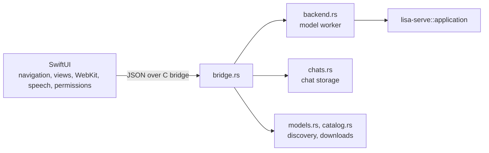

# Apple app

One SwiftUI app ([apps/Lisa](../apps/Lisa/README.md)) serves macOS 15+ and
iOS/iPadOS 18+. Its Rust services ([lisa-app](../crates/lisa-app/src/)) ship as
`liblisa_app.a` behind a two-function C bridge.

| Module | Owns |
| --- | --- |
| `bridge.rs` | Owned UTF-8 JSON requests and responses; Swift calls on a serial queue and frees returned strings |
| `backend.rs` | The model worker, session replay and streamed events; models never leave the worker thread |
| `chats.rs` | Chat JSON, model identity, drafts and owned attachments in app storage |
| `models.rs`, `catalog.rs` | Curated allowlist, local discovery, sizes, downloads |
| `prompt_cache.rs` | Up to two immutable prompt snapshots for the loaded conversation |
| `browser.rs` | Page extraction and browser messages |

## Building

Open the Xcode project, or build the Mac bundle with `sh apps/Lisa/bundle.sh`.
It produces `target/dist/Lisa.app` with the matching `kernels.bin`, icon and
notices, and keeps `Lisa.app.dSYM` outside the bundle. The `dist` profile uses
full LTO; presentation and networking code is size-optimized, inference code
stays at level 3. Never copy a kernel package from another build.

## Chats and navigation

The sidebar holds New chat, Models, Settings, Activity and Search, then saved
conversations; Mac and iPad use a split view, iPhone a drawer. Reopening a chat
reloads its pinned model and replays history; GPU state does not persist across
restarts. New installs default to Qwen 3.5 0.8B when it fits. Every chat gets
the current UTC date in its runtime system prompt.

Activity logs the user-observed output rate (tokens after the first over the
time from first to last token) and time to first token. These include app
overhead and are not engine benchmarks.

## Models and downloads

The allowlist is [`catalog.rs`](../crates/lisa-app/src/catalog.rs); search never
adds entries, and cached checkpoints appear only if their repository is listed.
Discovery shares snapshot ordering with the engine, validates package files
before listing, counts each inode once and hides models above the live memory
budget.

Downloads use the synchronous `hf-hub` client: authenticated metadata,
resumable transfers and progress for the selected files only. `HF_HUB_CACHE`,
`HF_HOME`, `HF_TOKEN`, token files and `HF_ENDPOINT` are honoured; rejected
ambient credentials fall back to anonymous metadata. Packages download
complete, including any `mtp/` sidecar. A curated Qwen 27B snapshot installed
without its `mtp/` sidecar completes it at its own revision on the next load;
if that fails (for example offline), the model loads without a drafter.

Speculation in the app: `auto` uses the loaded MTP head for greedy text chat;
Inkling's drafter runs tree rounds for greedy chat with repetition penalty 1.
Image turns, image history and the browser agent run serial.

## Prompt reuse and warmup

Olala, LFM3, Qwen and Inkling warm their bounded shapes once before
reporting Ready. The app's prompt cache keeps two snapshots per loaded
conversation at each model's prefix granularity, leaves the final natural
chunk intact and checks exact tokens and the law. Images and models without a
granularity bypass it; load, unload, clear and restore drop it.

## Lifecycle

- **iOS memory.** Admission uses the live per-app allowance minus 512 MiB,
  re-read for every admission. Memory warnings cancel work and release the
  model through the worker, without automatic reload.
- **Background.** On iOS 26+, user-started generation requests continued
  processing with background GPU access when the build has that entitlement;
  completion saves the chat and releases a backgrounded model. Personal-team
  builds lack the entitlement and stay foreground-only. Without authorization,
  entering the background cancels work; returning reloads and replays history.
- **Cancellation** happens at generation callbacks, not inside a forward.
- **Storage.** iOS supplies an app-container root, excludes models from backup
  and configures the Hub cache before workers start; attachment and image paths
  relocate when the container changes.

## Browser retrieval

The browser extracts links and headings, follows exact search-result links and
lets the model pick numbered results rather than build URLs. Consent and
verification pages are shown to the user, never automated. Replies quote
bounded excerpts with links; a failed read returns a retrieval failure.

## Limits

Physical-device acceptance is still needed for suspension, delivered memory
warnings, long contexts, browser, voice, image generation, serving and
background GPU builds. Simulator inference is blocked by a BF16 compiler-service
error; do not change weights or arithmetic to hide it.
