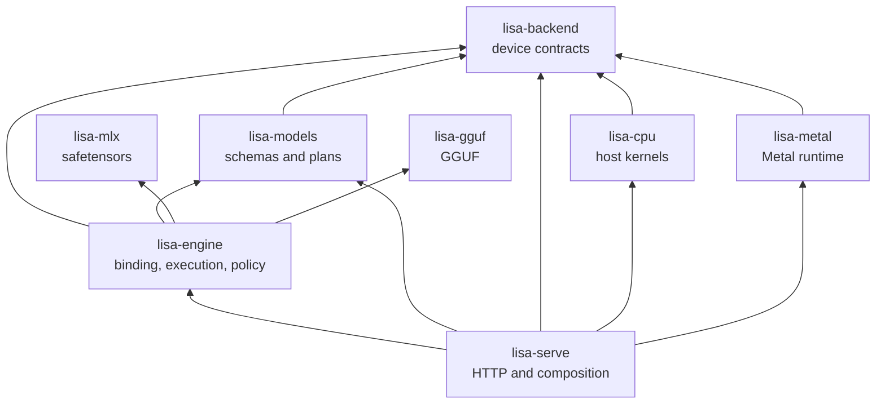
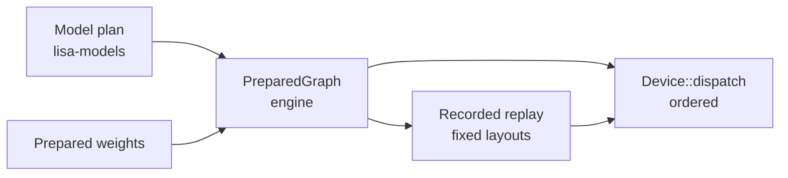
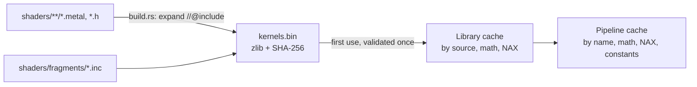

# Architecture

LISA separates four concerns: checkpoint storage, model computation, execution
policy and device operations. Format readers expose original bytes and
metadata. Model crates describe computation as plans. The engine binds tensors
to plans and owns every policy decision. Devices run operations they are given
and never see a model.

## Crates

The front ends sit on top: `lisa-cli` and `lisa-app` depend on `lisa-serve`,
`lisa-engine`, `lisa-models` and the format and Metal crates they call
directly; `lisa-bench` depends on every crate.

| Crate | Owns | Never does |
| --- | --- | --- |
| `lisa-backend` | Tensor import, storage views, kernel capabilities, prepared handles, completion | Model or format knowledge |
| `lisa-models` | Model schemas, computation plans, shape rules, numerical alternatives, memory formulas | File access, environment, devices, format crates |
| `lisa-mlx`, `lisa-gguf` | Checkpoint parsing, original encodings, mapped host storage | Depend on the engine or any device |
| `lisa-metal`, `lisa-cpu` | Device storage, kernels, queues, completion | Traverse models, choose policy, read checkpoints |
| `lisa-engine` | Resolution, weight binding, plan execution, memory admission, sampling, sessions, speculation | Depend on a concrete device |
| `lisa-serve` | HTTP adapters, request admission, provider composition (`application`) | — |
| `lisa-cli`, `lisa-app` | User commands; Apple app services and C bridge | — |
| `lisa-bench` | Diagnostics, benchmarks, goldens and real-device conformance tests | — |

Providers are constructed in `lisa-serve::application`, which exports the
device-specific type aliases the applications use; the engine and everything
below it stay generic. Applications may call runtime lifecycle functions
(platform check, kernel package initialization, memory limits, tracing)
directly. CI enforces the portable edges
([workflow](../.github/workflows/checkpoint-formats.yml)).

## Engine layout

| Module | Contents |
| --- | --- |
| `checkpoint/` | Resolution of directories, GGUF files and Hub IDs; configs, tokenizers, downloads |
| `weights/<model>/` | Checkpoint import for one model family |
| `bindings/<model>/` | Execution adapters and state for one model family |
| `bindings/shared/` | Operations shared by several families (affine, norms, gated delta, capture) |
| `language/` | The `LanguageModel` contract and its runtime adapter |
| `conversation/`, `cache/` | Sessions, prefix reuse, attention/recurrent/indexer state, batch cache packing |
| `generation.rs`, `batching.rs`, `scheduling.rs` | Serial generation, continuous batching, wave scheduling |
| `sampling/`, `speculation/` | Samplers and RNG; speculative transactions |
| `core/` | Model-independent graph execution, traversal, tokenization, scheduling helpers |

Model-specific logic lives under `bindings/<model>/` and `weights/<model>/`.
Shared modules speak in capabilities (`target_mtp`, block drafter, host
sampling), not model names. LISA reads no environment variables of its own:
the application sets the device, the RAM cap and Metal diagnostics once at
startup from command-line flags.

## Plans and execution

A plan declares symbolic inputs, weight slots, dependencies, output shapes and
the legal implementation alternatives. The engine validates and prepares it,
binds storage, and dispatches operations in dependency order. Unsupported
required operations fail. An optional operation may decline a geometry before
encoding and use the plan's declared fallback; it never substitutes another
arithmetic law silently.

**Recorded replay.** Fixed-shape regions can be recorded once and replayed with
new tensor inputs. Each recorded graph keeps up to eight exact layouts in
least-recently-used order; a miss executes normally and may replace the oldest
entry once it seals successfully. Replay re-checks layout, dtype, device and
storage aliases every time. Eviction never invalidates returned tensors or
their queued GPU users.

**Scheduling.** `ProgramScheduling::Ordered` is the default.
`DependencyParallel` lets a provider overlap independent dispatches after it
proves their storage dependencies. Metal builds an immutable hazard plan from
physical buffer aliases and inserts barriers for read-after-write,
write-after-read and write-after-write conflicts. Arithmetic, dispatch order
within a dependency chain and allocation admission do not change.

**Scratch.** Internal full-write tensors may share a 1 KiB-aligned arena.
Ranges overlap only when one tensor's last use precedes the other's first use.
Escaping outputs stay independent. An arena lease belongs to one command queue
and is reused only after every prior access is encoded on that queue.

`DeviceContext<D>` owns the device, optional diagnostics and typed prepared
state. Bindings, caches and samplers receive it explicitly; there is no global
or thread-local device.

## Device API

`lisa-backend::Device` exposes capabilities, `pull`, `prepare`, `dispatch`,
streams and `wait`. Capabilities describe dtype, encoding, layout, geometry,
numerical law and workspace needs.

| Contract | Mechanism |
| --- | --- |
| `TensorAccess` | Views, copies, evaluation, explicit readback |
| `StorageDevice` | Allocation limits and checked byte-preserving views |
| `HostAccessDevice`, `ReadbackDevice` | Layout inspection, host reads, synchronization |
| `ManagedDevice` | Memory accounting, residency reservations, submission, reuse scopes |
| `IndirectDevice`, `ResourceDevice` | Retained indirect operands, residency sets, full-write workspace |

The engine decides when to use each mechanism. `DeviceHandle` erases the
provider type while checking ownership of every tensor, handle and resource it
forwards.

Storage obligations:

- Copy imports finish reading their source before returning. `SharedRequired`
  retains immutable owned storage and never copies silently.
- Dropping a completion handle neither cancels work nor frees in-flight
  resources. Mappings and buffers outlive every queued user.
- No allocator lock is held while waiting for GPU completion.
- Only individually audited full writers may use uncleared storage; partial
  writers require initialization. Allocation padding is never tensor data.

## Weight import

Format readers expose tensors with their original encoding. The engine's
`weights::prepared` describes payloads, layouts and encodings independently of
the container: packed Q8/K/IQ/NVFP4 blocks and affine weight/scale/bias triples
stay distinct. Import preserves original bytes, scales, biases and groups; it
never requantizes. Deferred providers (`weights::source`) give bounded row
access for lazy embeddings, resident experts, staged image weights and the
disk-resident DeepSeek Engram table.

## Kernel packaging

Shaders live in `lisa-metal/src/shaders`, grouped by operation (`moe`,
`sparse_attention`, `kda`, `hyper`, `ple`, `gguf`, `native_*`, …). Rust launch
wrappers live in `jit/` and `kernels/`. Runs of source shared by several
headers live once in `shaders/fragments/` and are spliced in verbatim by
`build.rs`, so every kernel compiles exactly its original text. Provenance
pins hash the expanded sources and a test checks them.

Cargo writes `kernels.bin` beside each executable; the app bundles it in
Resources. A missing or mismatched package fails initialization.

Each runtime keeps two caches. The **pipeline cache** is keyed by kernel name,
math mode, NAX language target and function constants; a hit hashes those
fields and allocates nothing, and dispatch paths build kernel source only on a
miss (`compile_lazy`). The **library cache** is keyed by complete source text,
math mode and language target, bounded to 128 handles and 32 MiB of source,
and is consulted only on a pipeline miss. Source hashing and the
same-name/different-source check run only on misses; a collision is fatal.

## Adding a backend

A device crate implements the backend contracts: capabilities, imports, views,
storage, kernels and completion. The application registers it in
`lisa-serve::application`. Plans, readers, sampling and sessions are shared.
Each new provider needs its own kernel and model validation; compiling is not
support. CPU application composition builds without the `metal` feature and
currently serves Laya only.
