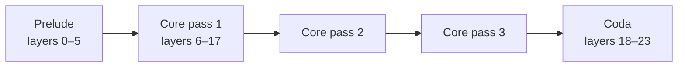

# Inkling 2 Mini

Experimental text, chat and still-image inference on one path: the GGUF
checkpoint run by the pinned reference's prefill and decode step.

| Identity | Package |
| --- | --- |
| GGUF `inkling2` | `unsloth/Inkling-2-Mini-GGUF`: `Inkling-2-Mini-UD-Q4_K_M.gguf` (16,610,543,328 bytes) and `mmproj-F16.gguf` (639,348,160 bytes) |
| DFlash2 drafter | `incoai/Inkling-2-Mini-DFlash2`, downloaded with the target |

The vendored kernels use the Metal 4 language and its tensor operations, so
loading requires an Apple7 (M1) or newer GPU on macOS or iOS 26 or later and
refuses other devices with a message; the app hides the model there. The
pinned reference supports Apple9 (M3) and newer. While the model is loaded,
its weights, the drafter's and every pooled device allocation (step scratch,
sequence state, step outputs) stay in one residency set that a 500 ms
heartbeat commits and requests again (one request holds about two seconds),
so idle gaps between requests do not unwire them; pool allocations join the
set when created and leave it when swept, and the set is not attached to the
queue. A sequence's state (extent, convolution cells, draft rings) and the
step's scratch are zeroed by device commands rather than on the host, so
starting a sequence does not clear hundreds of megabytes on the CPU.

Identities are pinned in [provenance](../../crates/lisa-models/src/inkling2/provenance.json);
the vendored kernels in their own
[provenance](../../crates/lisa-metal/src/shaders/reference/provenance.json).
Geometry, tensor names and the draft schema live in `lisa-models::inkling2`,
loading in `weights::inkling2::{gguf, dflash, vision}`, execution in
`bindings::inkling2` and its `step` module.

## Model

24 physical weight sets run as 48 applications: layers 6–17 run three times.
Each application owns its keys, values and short-convolution state; later core
passes are gated by messages of the completed pass. Hidden width 2,304, 24
query heads, 8 KV heads, head width 128, 128 experts with top-8 routing. Every
sixth layer attends its whole history, the others a 1,024-token window.
Learned relative positions, sinks, block residual mixes, message gates and
logit softcapping are part of the step. The head has 201,024 rows of which
200,058 are usable; EOS is 200006.

## Loading

The UD-Q4_K_M payload stores NVFP4 and Q5_K experts, Q8_0/BF16 dense
projections and F32 parameters. The loader keeps every original payload
resident and repacks beside them, once, without changing a value; the repack
reads the mapped payload in place (no host copy) and stages native rows on
every core for the GPU's `gguf_repack`, so loading takes about two seconds
from a warm page cache:

- each layer's routed experts into the reference's column-interleaved planes
  (gate, up, down), with a `[3, 128]` table of the scales its expert passes
  apply;
- the dense Q8_0 attention projections and the head into their planes;
- each loop layer's message queries (q, k, v, FFN) gathered from
  `loop_res_query` and `loop_kv_res_query` as F32.

The draft's projections are quantized as the reference's draft image stores
them: MLX affine 4-bit groups of 64 (BF16 scale and bias, round half away from
zero, the range's far end as the bias), q|k|v fused, repacked into planes. Its
norms, convolution kernels and codebooks stay BF16. Without the draft, the
target loads alone and generation is serial.

## The step

`step::target::Step` encodes one step of 1 to 16 rows of one sequence as the
reference's host encodes it: every dispatch a vendored kernel
(`PackedCompute::Vendored`), with the reference's tiles, splits and expert
passes, bf16 activations and layer outputs, an F32 in-layer residual. Rows form
a tree (a chain is a tree): row r sits at the committed count plus its depth
and its attention and convolutions read its root-to-row path. A step writes
softcapped F32 logits and the draft's captures (the inputs of applications 5,
23 and 41 and the final norm's output). A commit moves the accepted path's keys
and values to their committed slots and writes the next convolution state from
the step's tape.

Kernel selection follows the reference's calibration
(`step::calibration::Calibration::of`), one row per Apple GPU class (Apple9,
Apple10, Apple11 and newer; M1 and M2 take Apple9's rows, which the
reference has no class for) and, where its measurements say so, per core
range: register and staged tile boundaries, tier or wave split laws, the
16-row lane, spread walks, one-pass gate/up pairs, the float tile, the
attention's pages per prompt split and INT8-query threshold (never on Apple9),
the int8 prefill tile (Apple10 and newer) and 64-row expert tiles (the M5
Pro's core range). Bits depend on the GPU's family and core count through the
attention splits and the dense tiles' choices and K splits, and on the row
count through the tile selection.

## Sequence state

A sequence's cache (`LayerCache::Native`) owns its step state
(`step::state::StepState`):

- one extent of paged INT8 keys and values for all 48 applications (32-token
  pages; keys token-major, values dimension-major, one F32 scale per token and
  head; full applications' regions first) and its page table;
- the double-buffered bf16 convolution state (the last three inputs of every
  convolution);
- the committed token count;
- with a draft, its context rings: each draft layer's keys and values of the
  last 2,048 positions (position `p` at slot `p mod 2048`).

Extents start at the prompt plus 2,048 tokens and grow in 2,048-token steps;
growth copies the committed pages. Kernel offsets bound a sequence to 43,008
tokens, below the checkpoint's context. A snapshot is the cache's shared
state; the first write to a shared state copies its committed pages,
convolution state and rings on the device. Prefix-cache entries and session
snapshots therefore restore without relayout.

The numerical law is `0x494e4b3253540000`. Image prompts have no law and are
not prefix-cached.

## Prefill and serial decode

Prompts run the reference's prefill (`Step::prefill`): chunks of up to 2,048
rows from the committed position, each one pass over the 48 applications with
the prompt kernels. The relative attention stages the chunk's queries, stores
its keys and values in their pages (the decode step's format) and attends
through split and reduce passes, or the direct kernel where the chunk's tiles
take one history split each; convolutions write the state after the chunk's
rows into the next cell; mixes past 64 rows and message gates past 128 rows
run the row kernels; dense projections past 64 rows run the int8 prefill tile
(the bf16 prefill tile on Apple9), shorter ones the decode tiles; the experts
group a chunk's routes into 8-, 32- or 64-row tiles and combine before the
FFN convolution. The draft's context takes the captured rows of the prompt's
last 2,048 positions through its context projection, hidden norm and per-layer
key/value prefill into the rings. The first token reads the last row's head.
A prompt split at a chunk's end prefills its rest as the whole prompt's chunks
do (prefix granularity 2,048). The step's scratch is zeroed on the device; a
chunk's scratch is sized for the longest chunk yet, and warmup runs a whole
2,048-row chunk first (about 0.7 GiB held from load), so no request allocates
it. Serial greedy decode and sampled generation run
one-row decode steps; the host's sampler reads the step's logits.

## Tree rounds

Greedy generation with the draft runs tree rounds (`--tree-nodes` caps a
round's rows, 16 by default; a fixed `--depth d` caps them at `d + 1`). A
round follows the reference's decode cycle:

- **Host plan.** A prompt-lookup chain of up to `min(depth, 15)` tokens
  follows the most recent earlier occurrence of the longest suffix (three to
  64 tokens) of the committed tokens and the anchor; `depth` is the output
  left past the anchor, at most 15. Each chain token carries learned rates by
  its agreement with the draft. The row count maximizes expected tokens per
  millisecond from the request's last tree's estimates (a request's first
  round, a draft block's) and a measured table of round costs per row count
  plus a learned cost per pass over history.
- **Draft.** The draft step embeds the anchor and seven mask tokens (200056)
  through the target's token table and norm; each of its five layers runs
  dynamic two-tap convolutions, q|k|v head norms and RoPE (base 10,000), and
  split attention over the rings and the eight block rows; then the final
  norm, the target's head over the 200,058 valid tokens and the candidate
  selector's top sixteen and bilinear edge tables.
- **Device tree.** The reference's tree selection grows a best-first tree over
  that lattice and the chain (four children per draft row, up to 16 rows) and
  lays out its verify rows. Nothing is read back before verification.
- **Verify, accept, commit.** One step verifies every row. Behind it, on the
  device, the greedy picks select the accepted path and the target's and the
  draft's commits of it are encoded before the one readback; the host's walk
  of the same picks emits each visited row's pick and only advances counters.
  The tree's labels refit the acceptance model; the chain's outcome updates
  its rates; the round's time to its results, without the caller's handling
  of its tokens, updates the history cost. These learned estimates persist
  across requests of the loaded model, as the reference's do.

The cost table is measured on first use and stored per machine and model law
(`tree_cost.json`). A one-row round is arithmetically a serial step. Rounds of
more rows run other tiles and splits, so greedy speculative output can leave
serial greedy output where the target's top two logits are close;
`lisa-bench spec-check` reports the first divergence and its logit gap.

## Images

The encoder is a 23-layer ViT with learned positions, a CLS token, two-axis
rotary positions, 20-pixel patches, 2×2 merging and a two-layer projector, run
with F32 attention over at most 1,024 patches per image. The projector is
loaded lazily and released after encoding, with a 2 GiB scratch margin. Each
image marker expands to one row per feature; the step replaces those rows'
token-table rows after the embedding norm with the features rounded to bf16.
Image prompts prefill as text prompts do, their rows injected in each chunk, and generate serially.

## Validation boundary

Self-contained tests check the vendored ABI layouts, dispatch geometry, the
calibration rows and tile law against the reference's own choices on Apple9,
Apple10 and Apple11 devices, schedule, state layout, plane repacks and draft
quantization. Model-level
checks are `lisa-bench` commands (`spec-check`, `session-check`,
`prefix-check`). Checkpoint-level parity with the reference is not certified by
the test suite.

Batching, audio, Apple7, Apple8, Apple9 and Apple11 hardware (their rows
follow the reference's calibration, unmeasured on those GPUs; M1 and M2 are
outside the reference's support), contexts past 43,008 tokens, broad
language and image quality and mobile memory limits remain unqualified.
