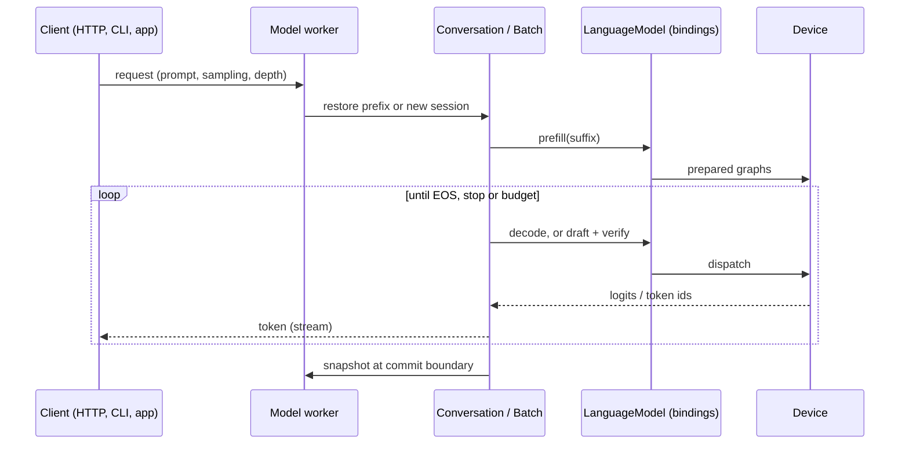
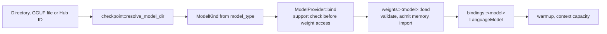
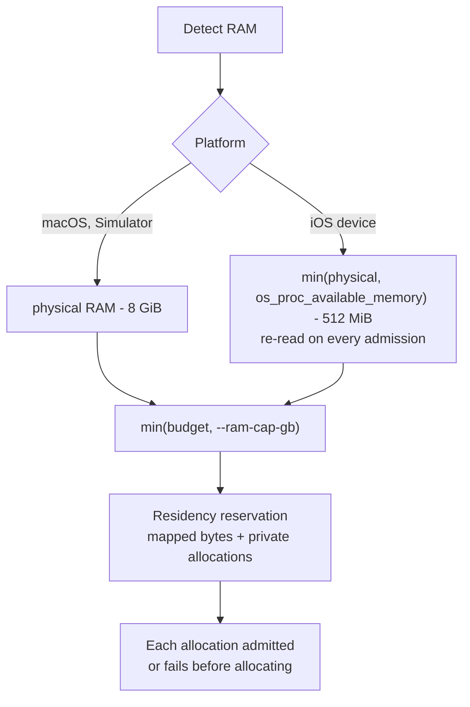
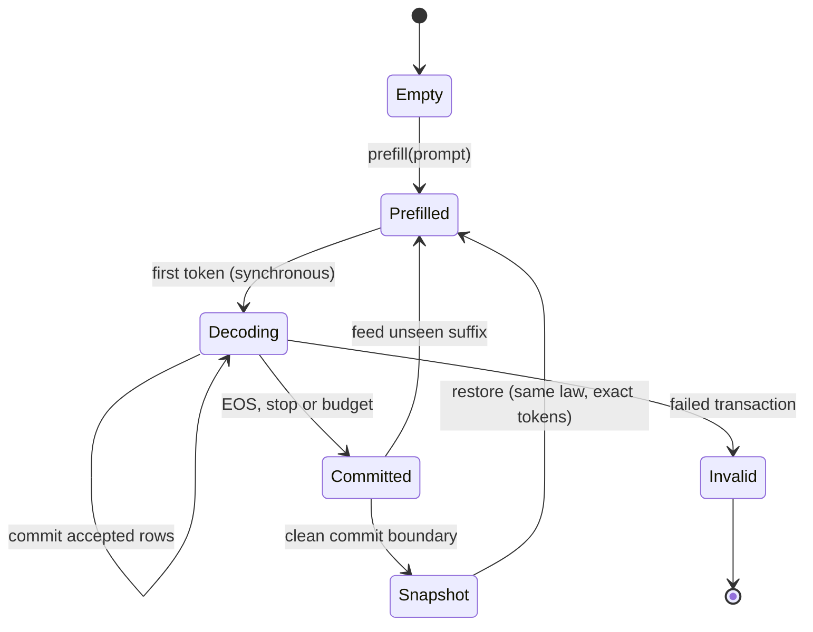
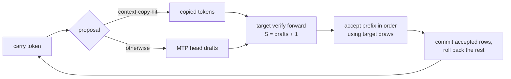

# Runtime

How a model is loaded, how memory is admitted, and how a prompt becomes tokens.
Numerical rules for every step are in [numerics](numerics.md).

## Request path

One worker thread owns the loaded model; models never cross threads. The HTTP
server, CLI and app all submit work to it. A conversation owns committed
tokens and model state; the worker routes eligible concurrent requests through
batching instead (see [scheduling](#scheduling)).

## Loading

- **Resolution.** A local directory, a supported GGUF file or a Hugging Face
  repository ID resolves to one checkpoint; ambiguity or an unsupported type
  fails. Hub downloads pin a commit revision. A `.lisa-incomplete` marker
  hides a snapshot until every selected file has its advertised size; retries
  reuse complete files and repair truncated ones.
- **Identity.** `ModelKind` maps checkpoint identifiers (`model_type` or GGUF
  `general.architecture`) to a model plan. Identifiers are checkpoint
  contracts and are never renamed after products.
- **Import.** Weight adapters read actual dtypes, shapes, groups and encodings,
  preserve original payloads and fail on unsupported ones. Safetensors are
  mapped, not copied. Packed GGUF blocks are bound directly.
- **Context.** Default capacity comes from checkpoint metadata
  (`<arch>.context_length` for GGUF, `text_config.max_position_embeddings`
  then the root field for JSON). An explicit `--ctx-size` applies afterwards
  and still passes model validation and memory admission. Capacity is not a
  parity claim at that length.
- **Model switch.** The previous model is released before the next loads.

Per-model packaging rules (GLM's prepared resident index, DeepSeek's
disk-resident Engram table, Qwen's `mtp/` sidecar) are on the model pages.

## Memory admission

`lisa_engine::memory` owns detection. `--ram-cap-gb` (a CLI flag or app launch
argument) can only lower the budget, and failed detection refuses admission.

- A residency reservation counts unique mapped model bytes once plus private
  pool bytes. Admission happens before each new allocation; completed unused
  buffers may be reclaimed first. Dropping one reservation never resets
  another's.
- Without a reservation, the pool uses a 512 MiB soft reuse threshold with
  growth-triggered trimming. This threshold is not the model budget.
- `active_memory()` includes reservations; `private_allocated_memory()` does
  not. `peak_memory()` reports live allocation, not a high-water mark.
- HTTP request admission (enabled by `--ram-cap-gb`) is a separate check;
  see [serving](serving.md#admission).
- On iOS, memory warnings cancel work and release the model through the worker.
- `--kv-format` selects key/value storage. `auto` (the default) uses 8-bit
  caches with one F32 scale per token and head wherever a model implements
  them, else the model's own format; `native` keeps each model's own format,
  and `int8` requires 8-bit caches (other models refuse to load). Inkling 2's
  own format is the step's paged INT8 cache, so every setting keeps it.

## Sessions and prefix reuse

A session holds committed tokens, attention and recurrent caches, draft state
and absolute positions. The final emitted token stays unfed until the next
turn. A continuation feeds only the unseen suffix; it must match an equivalent
full prefill under the same law. A failed stateful transaction invalidates the
session instead of exporting half-updated caches.

The prefix cache (`cache/prefix.rs`) stores snapshots taken at clean commit
boundaries:

- minimum stored prefix of 128 tokens, at complete prompt boundaries;
- exact token match with strict extension: an identical prompt cannot reuse its
  last boundary as if a next-step logit were stored;
- RAM entries in least-recently-used order with an entry-count bound (no byte
  budget yet), plus up to eight spill files for serializable state types;
- every entry is bound to the model's numerical law; a foreign law never wins
  lookup or restore.

Models declare a prefix granularity (Qwen MLX 2048, Qwen GGUF 16, Inkling 2048,
LFM3 8) so a saved prefix never repartitions chunk-dependent arithmetic.
Native DeepSeek and Inkling state support copy-on-write RAM snapshots but no
spill.

## Speculative decoding

Only draft heads shipped with the checkpoint are supported:

| Mechanism | Models | Depth |
| --- | --- | --- |
| Independent MTP head with context-copy hits | Qwen 27B MLX, Qwen Flash-Next | 2–6 (copy hits up to 7) |
| Embedded MTP block | Qwen 27B GGUF | up to 2 |
| Target-conditioned MTP | GLM-5.3 | 2 drafts, up to 3 tokens committed |
| DFlash2 draft, tree rounds | Inkling 2 | trees of up to 16 rows |

- **Depth.** `auto` uses the expected-value controller for independent heads
  and tree rounds for block drafters; `0` is serial; an unsupported fixed depth
  fails. The controller reads trusted round-cost cells
  (`TABLE_MIN_SAMPLES = 3`), prefers the nearer lower KV bucket and keeps
  per-depth acceptance averages. Output and context budgets shorten rounds
  before work is scheduled.
- **Context copy.** A rolling 3-gram index over committed tokens proposes the
  continuation of an earlier occurrence. Self-overlapping sources and
  continuations shorter than two tokens are rejected. A copy proposal changes
  cost, never the emitted target token.
- **Acceptance.** Proposals are compared in order with ordinary target draws,
  using the serial repetition history, absolute position and RNG. No rejected
  suffix consumes a target sample. For deterministic proposals under sampling,
  acceptance is `min(1, p_target(t))` and rejection samples
  `normalize(max(p_target - one_hot(t), 0))`.
- **Commit.** If a round emits `r` predictions from `[carry, drafts…]`, the
  first `r` input rows are kept, even when the last prediction is EOS. Draft
  history, recurrent and attention caches truncate to the same point.
- **Tree rounds.** A block drafter drafts a tree after the carry, verifies it
  in one target step and commits the path the target's greedy picks walk;
  each round chooses its rows (up to `--tree-nodes`, or a fixed depth plus
  one) from measured costs and learned acceptance. Sampled targets decode
  serially. See [Inkling](models/inkling2.md#tree-rounds).

Qwen's independent head shortlists 32 candidates with a derived 2-bit/group-64
copy of the output head and rescores
them with exact trunk-head rows; verification always uses the original head.

## Scheduling

- **Serial lookahead.** Models may opt into one-token-ahead serial execution
  for static greedy sampling. The first token is synchronous; a pending append
  commits only after the current token is accepted. EOS, cancellation and
  errors restore uncommitted state.
- **Batching.** Four or more eligible requests may run through continuous
  batching. Each row attends its own positions; padding is capped
  (`MAX_PAD_WASTE = 1.5`); retirement and repacking preserve retained rows
  exactly. Chunked prefill can yield to decode between chunks. A model that
  declines batching uses its serial path.
- **Timing.** `GenerationStats.generated_tokens` includes the first token.
  Decode throughput counts later tokens only, from the first token callback to
  the last.

## Prompt execution

| Model path | Prefill shape |
| --- | --- |
| Qwen 27B MLX | Chunked tower forward, 2048-row chunks |
| Qwen 27B GGUF | 16-row windows |
| Qwen Flash-Next | Chunked tower forward with model-owned GDN, sparse attention, PLE and MoE plans |
| GLM-5.3 GGUF | Up to eight rows per layer; grouped FFN projections, ordered KDA and DSA state |
| GLM-5.3 MLX | Chunked prefill with shape-specific wide schedules |
| DeepSeek V4.1 | Layer-major groups of one to eight rows; causal attention per row |
| Inkling 2 | The reference's prefill: chunks of up to 2048 rows from the committed position |
| Olala | Up to eight rows per layer |
| LFM3 | Up to eight rows per graph |

Grouping dispatches does not imply matrix arithmetic: kernel selection follows
the loaded law and exact shape gates.
